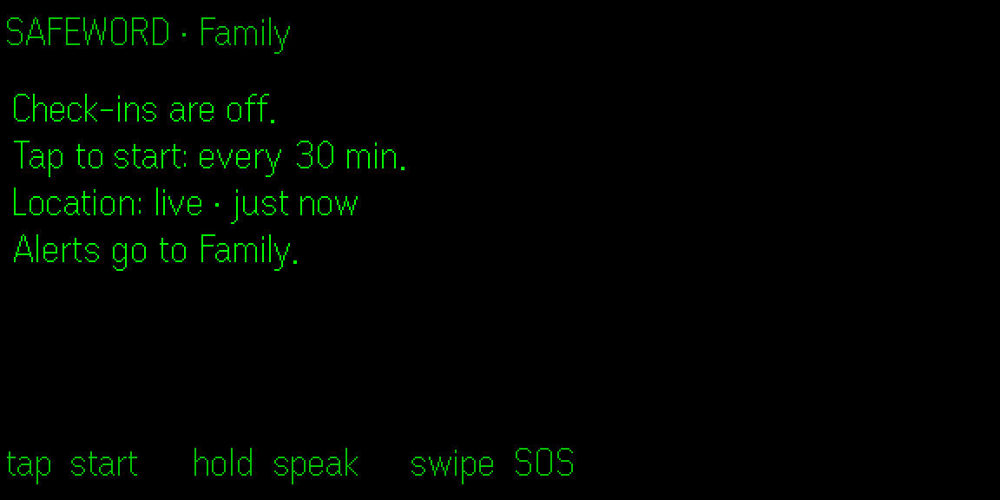
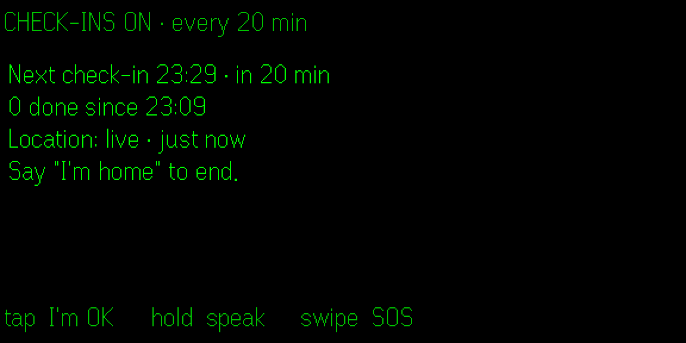
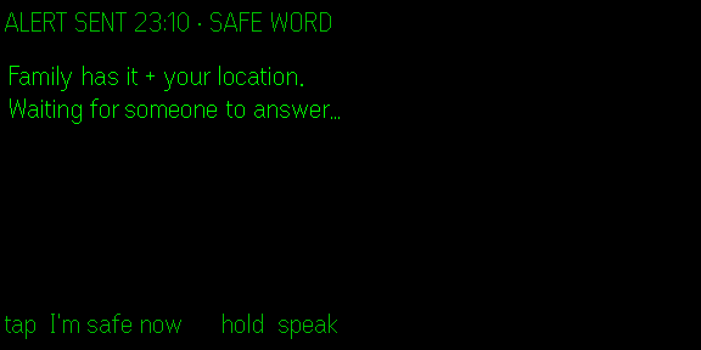
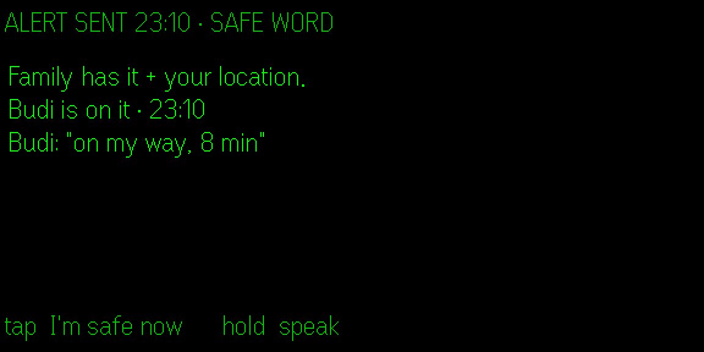
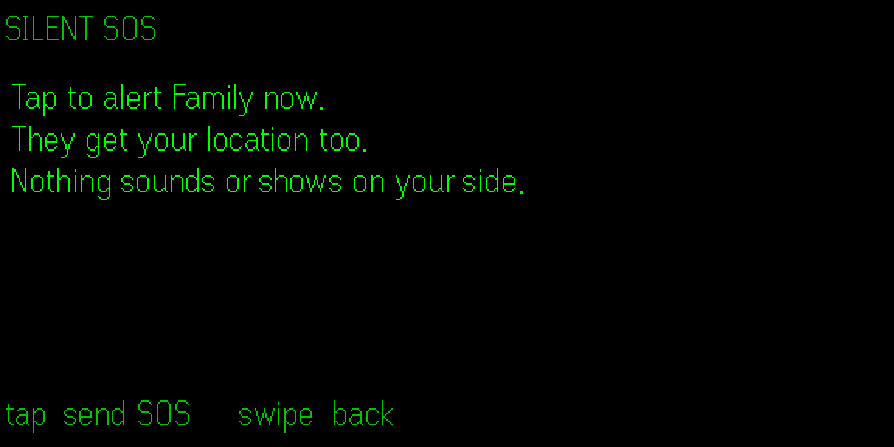

# SafeWord

**A silent alarm in your glasses, a safe word in your voice, and the people who matter on Telegram.**

Walking home late, a delivery run, a site visit on your own: when something goes wrong you often
can't take out a phone. Reaching for it is visible, and sometimes it makes things worse. SafeWord
runs on Even Realities G2 glasses and keeps a small group of people (your *circle*, a Telegram group)
one gesture or one sentence away:

- **Check-ins.** Start a walk or a shift ("check on me every 20 minutes"). When a check-in is due the
  glasses ask *Are you OK?*; one tap answers. No answer within two minutes and your circle gets an
  alert with your location.
- **Silent SOS.** Swipe, tap. Nothing sounds or flashes on your side.
- **A safe word.** Hold the touchpad and say an ordinary sentence with your word in it: *"Yeah I'm fine,
  we're just getting pineapple pizza."* Whoever is next to you hears small talk. Your circle gets
  *"Konz said their safe word: someone may be listening, don't mention SafeWord if you call."*
- **Help you can see.** Someone in the circle taps **I'm on it** or replies to the alert, and it shows
  on your glasses: *"Darmo is on it · 23:42"*, *"Darmo: on the way"*.

| Check-ins off | Check-ins on | Safe word said | Help is coming | Silent SOS |
|---|---|---|---|---|
|  |  |  |  |  |

*Even Hub simulator, 576 × 288 monochrome.*

## Track

Messaging & News (Telegram: bot, group, inline buttons, replies, live location). Also entered for
Best Telegram integration.

## Why it is built this way

- **The timer is on the server, not in the glasses.** A G2 app shows nothing once you switch away, and
  a phone can die. Check-ins are counted by the SafeWord server, so a missed check-in raises the
  alert even if the app is closed or you can't touch anything.
- **Fails loudly, retries quietly.** An alert that can't be delivered (no network, Telegram down) is
  retried every second until it goes out, and the glasses say *Sending… retrying* meanwhile. With no
  circle linked the glasses say plainly *alert NOT sent*.
- **The phone is a backup, not the main input.** When a check-in is due, the bot also asks you in your
  private chat with an *I'm OK* button.
- **Private by default.** Speech-to-text (Whisper tiny.en) runs locally on your server: no audio leaves
  it and no API key is needed. Your live location goes only to the bot; the circle gets a pin only
  when an alert goes out. `/codeword` messages are deleted from the chat right away. The bot reads
  only commands and replies to its own messages in the group (privacy mode stays on).
- **One open alert at a time.** A second trigger (say, the safe word after a missed check-in) upgrades
  the open alert instead of spamming the group.

## Controls

| Card | Tap | Swipe down | Swipe up | Hold and speak |
|---|---|---|---|---|
| Check-ins off | start (default every 30 min) | silent SOS card | | "check on me every 20 minutes", "walk me home" |
| Check-ins on / due | I'm OK | silent SOS card | end check-ins | "I'm fine", "tell them I'm on the train", "I'm home" |
| Silent SOS | send | back | back | |
| Alert open | I'm safe now (with a confirm step) | | | "I'm safe", "false alarm" |

The safe word works in any sentence, on any card, and wins over every other phrase. It tolerates a
one-letter slip from speech-to-text ("pineaple") but not unrelated words. Double-tap exits.

Telegram, private chat with the bot: `/codeword pineapple`, `/every 20`, `/name`, `/status`,
`/checkin`, `/test` (a labelled test alert to the circle). In the group: `/circle@yourbot` (wearer only).

## How it is built

```
Telegram: your private chat (setup, check-in backup, live location)
          your circle group (alerts, "I'm on it" buttons, replies)
                 │
                 ▼
SafeWord server: check-in timer, alerts, retries ──> /api/view (long-poll) ──> G2 app
        ▲                                                                        │
        └────────────────────── /api/input, /api/voice <─────────────────────────┘
```

- `app/`: the Even Hub web app (Vite + TypeScript + `@evenrealities/even_hub_sdk` 0.0.16). A thin client:
  three stacked text containers (header, body, footer), redrawn only when their text changes. Taps
  and swipes go to the server; the G2 microphone streams PCM while you hold the touchpad.
- `server/`: Node 20+, no database, state in one JSON file.
  - `engine.js` the check-in timer, alerts, responses and the card state machine (clock and Telegram
    injected, so every path is tested); `views.js` card and alert text; `intent.js` transcript to
    action, including the safe-word match; `telegram.js` Bot API long-polling, buttons, edits,
    locations; `stt.js` local Whisper.
- Tests: `cd server && npm test` (16 tests: missed check-ins, grace period, circle responses, safe
  word in a sentence and misheard, retries when Telegram is down, no circle, restart).

## Run it

Requirements: Node 20+, the Even Hub simulator (`npm i -g @evenrealities/evenhub-simulator`) or a G2.

```bash
# 1. server
cd server
npm install
npm run fetch-model            # Whisper tiny.en (~43 MB), once, into server/models
cp .env.example .env           # put your BotFather token in TELEGRAM_BOT_TOKEN
npm start                      # http://127.0.0.1:8788

# 2. glasses app
cd ../app
npm install
npm run dev                    # http://127.0.0.1:5174
npm run simulate               # Even Hub simulator on the app
```

Then in Telegram:

1. Send `/start` to your bot (you become the wearer), then `/codeword <word>`.
2. Make a group with the people who should hear about it, add the bot, send `/circle@yourbot`.
3. Share your live location with the bot (📎 → Location → Share My Live Location).
4. `/test` sends a labelled test alert so everyone sees what one looks like.

Without Telegram, `npm run demo` starts the server with dev endpoints: messages go to the log and
`POST /api/dev/say {"text": "..."}` stands in for push-to-talk. A phone on the same Wi-Fi reaches the
server with `HOST=0.0.0.0`; open the app with `?api=http://<server-ip>:8788` and add that address to
the `network` whitelist in `app/app.json`. `npx vite build && npx evenhub pack app.json dist` builds
the `.ehpk`.

## Built during the hackathon

Everything in this repository was written for Heads Up (from Nov 23, 2026). It uses these existing
pieces: the Even Hub SDK, CLI and simulator, the Telegram Bot API, `@huggingface/transformers` with
the `Xenova/whisper-tiny.en` model, Vite and TypeScript. The thin-client app shell, the Telegram
long-polling and the Whisper wrapper are shared with my other entry, CalledIt, written the same week.

## Limits

- Tested in the Even Hub simulator only; no G2 hardware was available. The demo video uses one
  Telegram account as the wearer and a second account as the circle member who responds.
- SafeWord is a personal safety aid, not an emergency service: it alerts people you chose, it does
  not call the police.
- The glasses show the check-in prompt only while the app is open; the alert fires either way.
- Speech-to-text is English only (whisper tiny.en). The safe word should be a word you would not say
  by accident.

## License

MIT
